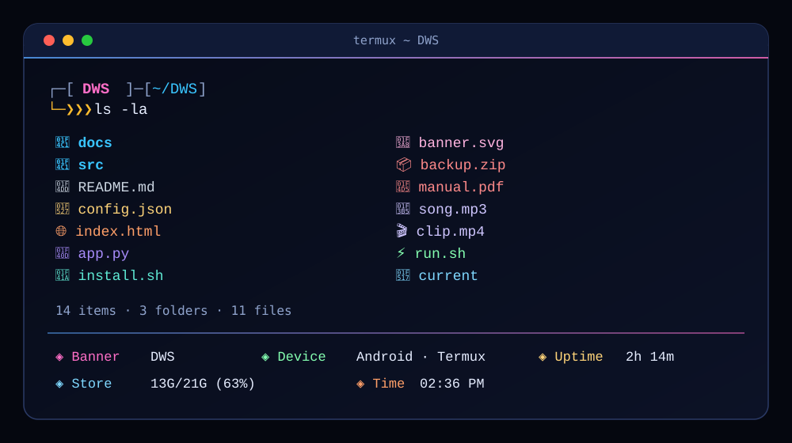

<p align="center">
  
</p>

<p align="center">
  <a href="https://github.com/d-rathnayake/DWS/actions/workflows/ci.yml"></a>
  
  
  
  
</p>

<h1 align="center">DWS PREMIUM V1</h1>

<p align="center">
  <b>A neon terminal toolkit for Termux and Linux.</b><br/>
  Block-letter banner · icon-coloured files · handy tools · works offline
</p>

<p align="center">
  <sub>Developer: <b>d-rathnayake</b></sub>
</p>

---

## ✨ Preview

<p align="center">
  
</p>

---

## 🚀 Features

| | What you get | Notes |
|:-:|---|---|
| 🔤 | **Block-letter banner** | Your name in a 3-row neon gradient, shown when a shell opens |
| 🗂️ | **Icon `ls`** | Folders first, icon and colour per file type. No special font needed |
| 🧭 | **Live dashboard** | Device, uptime, storage and time, at a glance |
| 🕰️ | **Big clock** | `dws clock` shows the time in block letters; `-w` for live |
| 💬 | **Smart suggestions** | Grey history suggestions while you type. **Right arrow** or **Ctrl+E** accepts |
| 📝 | **Notes and todos** | Quick notes, plus a simple todo list |
| 🧮 | **Tools** | Calculator, password generator, SHA-256, text search, disk-usage bars |
| 🌳 | **Folder tree** | `dws tree` with icons and a depth limit |
| 🩺 | **Health check** | `dws doctor` confirms the install is working |
| 🔒 | **Private by design** | No telemetry, no remote code. Only `weather` and `speedtest` use the network |
| 🧹 | **Clean install** | Everything lives in `~/.dws`. Re-running never duplicates shell hooks |

---

## 📦 Install

Works on **Termux** (Android) and **Debian/Ubuntu** Linux.

**Option 1: from the release zip**

```bash
unzip -o DWS-v1.zip
cd DWS
bash install.sh
```

**Option 2: from git**

```bash
pkg install -y git                  # Linux: sudo apt install git
git clone https://github.com/d-rathnayake/DWS.git
cd DWS
bash install.sh
```

The installer asks two quick questions (banner name, and whether to delete the installer folder), then runs with one progress bar. When it finishes, the screen clears and a new zsh session opens with the banner.

> **Tip:** the banner name is 1–10 letters, numbers or a hyphen. Press Enter to use `DWS`.

---

## 🧪 Commands

| Command | What it does |
|---|---|
| `dws` | Dashboard |
| `dws info` | System, tool and install details |
| `dws doctor` | Health check |
| `dws name [NAME]` | Change the banner name |
| `dws ls [-a] [-l] [path…]` | Icon-coloured listing (`-a` hidden, `-l` details) |
| `dws tree [folder] [depth]` | Folder tree with icons |
| `dws search <text> [folder]` | Search text inside files |
| `dws hash <file>` | SHA-256 checksum |
| `dws size [folder]` | Largest items, with bars |
| `dws note [text]` | Quick notes (`dws note clear` empties them) |
| `dws todo [add/done/rm/clear]` | Simple todo list |
| `dws calc <expr>` | Calculator, e.g. `dws calc (12+8)*3/2` |
| `dws pass [len]` | Random password, 8–128 characters |
| `dws clock [-w]` | Big clock (`-w` for live) |
| `dws ip` | Local IP address |
| `dws battery` | Battery level (needs Termux:API) |
| `dws weather` | Weather (needs internet) |
| `dws speedtest` | Download speed (needs internet) |
| `dws uninstall` | Remove DWS and its shell hooks |
| `dws version` | Print the version |
| `dws help` | Full command list |

### Quick examples

```bash
dws name My-Brand          # new banner name, shown in new shells
ls -la                     # icon listing with hidden files and details
dws todo add ship it
dws todo done 1
dws calc 2^10              # 1024
dws pass 24
dws search TODO ~/code
dws tree ~/projects 3
```

---

## 🎨 Icon legend

In zsh, `ls`, `ll`, `la` and `lla` all use the icon listing.

| Icon | Type | Icon | Type |
|:-:|---|:-:|---|
| 📁 | Folder | 🎨 | Images |
| 🐚 | Shell script | 🎬 | Video |
| 🐍 | Python | 🎵 | Audio |
| 📜 | JavaScript / TypeScript | 📦 | Archives |
| 💻 | Other source code | 📱 | Android packages |
| 🌐 | HTML / CSS | 💾 | Databases |
| 🔧 | Config and data (JSON, YAML, env…) | ⚡ | Executable |
| 📝 | Text and Markdown | 🔗 | Symbolic link |
| 📕 | Documents and PDFs | 📄 | Everything else |

---

## ⌨️ Shell

- Two-line prompt with the banner name and current folder.
- Exit-code badge on failed commands.
- A timer for any command that takes 2 seconds or longer.
- **History suggestions**: start typing and the rest of the last matching command appears in grey. Press **Right arrow** or **Ctrl+E** to accept. Tab completes as usual.

Settings you can export before the shell loads:

| Variable | Effect |
|---|---|
| `DWS_QUIET=1` | Do not show the banner when a shell opens |
| `DWS_NOSUGGEST=1` | Turn off history suggestions |

---

## 🗂️ Files

```
~/.dws/
├── bin/dws          the command
├── dws.zsh          shell prompt, settings and suggestions
├── name             your banner name
├── notes.txt        created when you add a note
├── todo.txt         created when you add a todo
└── backup/          originals saved before any change
```

The installer adds one marked block to `~/.zshrc` and `~/.bashrc`:

```sh
# >>> DWS >>>
...
# <<< DWS <<<
```

---

## 🛡️ Privacy and security

- No telemetry. Nothing is sent anywhere.
- No remote code: nothing is downloaded and executed. Every script is plain, readable Bash or zsh.
- Only `weather` and `speedtest` use the network, and only when you run them.
- `calc` accepts numbers and operators only, so it cannot run commands.
- Your original shell files are backed up in `~/.dws/backup` before any change.

---

## 🧰 Development

```bash
bash tests/smoke.sh        # installs into a throw-away HOME and checks everything
```

The smoke test covers install, re-install, the commands, the shell hooks and uninstall. It never touches your real home folder.

GitHub Actions runs on every push and pull request:

- **Lint**: `shellcheck` (errors) on the scripts, and XML validation of the banners.
- **Smoke test**: the full install-and-run check on Ubuntu.

### Release

Tag a version and push it. The release workflow runs the smoke test, builds `DWS-<tag>.zip` from the tracked files, and publishes it as a GitHub release.

```bash
git tag -a v1.0.0 -m "DWS PREMIUM V1"
git push origin v1.0.0
```

---

## ❓ Troubleshooting

| Problem | Fix |
|---|---|
| Still in bash after install | Run `exec zsh`, or close and reopen Termux. |
| Suggestions do not appear | Check that `DWS_NOSUGGEST` is not set. Type at least one character that matches an earlier command. |
| Icons show as boxes | Your font lacks emoji. Termux's default font supports them. |
| `dws doctor` reports zsh missing | Run `pkg install zsh` (or `sudo apt install zsh`), then `bash install.sh` again. |
| Want everything removed | Run `dws uninstall`, type `YES`, then restart the terminal. |

---

## 📄 License

**All rights reserved.** You may view this project on GitHub and run it on your own device. Copying, modifying, redistributing or forking requires written permission from the author. See [LICENSE](LICENSE).

---

<p align="center">
  <sub>◈ Crafted by <b>d-rathnayake</b> ◈</sub>
</p>
